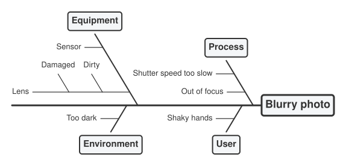

<h1 align=center>Raspa</h1>

<p align=center>Fishbone (Ishikawa) diagrams as code. Write an indented outline, get an SVG.</p>

<p align=center>
  <a href="https://github.com/HugoAlvarezAjenjo/Raspa/actions/workflows/ci.yml"></a>
  <a href="https://github.com/HugoAlvarezAjenjo/Raspa/actions/workflows/release.yml"></a>
</p>
<p align=center>
  <a href="https://github.com/HugoAlvarezAjenjo/Raspa/releases/latest"></a>
  
  
  
  
  <a href="LICENSE"></a>
</p>

## Example



```
Blurry photo
  Process
    Out of focus
    Shutter speed too slow
  User
    Shaky hands
  Equipment
    Lens
      Dirty
      Damaged
    Sensor
  Environment
    Too dark
```

Source: [docs/example.raspa](docs/example.raspa)

## Build

Requires Java 21. Maven comes with the repo (`./mvnw`).

```
git clone https://github.com/HugoAlvarezAjenjo/Raspa.git
cd Raspa
./mvnw package
```

This runs the tests and builds `target/raspa.jar`. Then:

```
java -jar target/raspa.jar diagram.raspa
```

Writes `diagram.svg` next to the input. From Java, `Raspa.toSvg(source)` returns one SVG per diagram.

## Syntax

- First line: the effect (the fish head).
- Indented lines: causes. Deeper indentation = sub-cause.
- Any indent width, spaces only.
- `'` starts a comment.

## Several diagrams in one file

Wrap each one in `@startfishbone` / `@endfishbone`. Text outside the blocks is ignored, so they can live in a `.puml` file next to PlantUML diagrams.

```
@startfishbone
Slow build
  Tests
    Too many integration tests
@endfishbone
```

## Coming from Mermaid

Delete the `ishikawa-beta` line; the rest works as is.

## License

[MIT](LICENSE)
